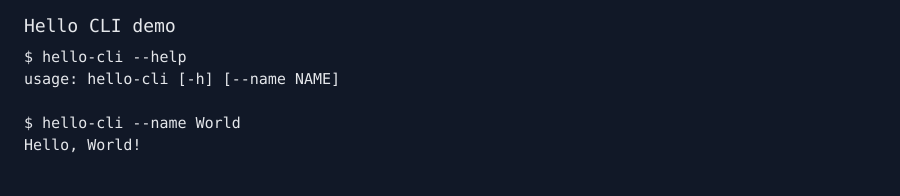

# DemoProof

Show what your CLI actually does with a reproducible, privacy-checked demo made from a supplied terminal transcript.

DemoProof is a Python 3.10+ command-line tool and a Codex Skill. It turns UTF-8 terminal text into a static SVG or HTML page, a Markdown embed, a redaction report, and a SHA-256 provenance manifest. It does not run transcript commands. No account, server, network call, telemetry, paid API, or third-party Python runtime package is required.

## Quick start

1. Save an illustrative or previously captured transcript as `examples/sample-transcript.txt`.
2. Check it: `python -m demoproof check --input examples/sample-transcript.txt`.
3. Render it to an absolute output directory.

PowerShell, from the repository root:

```powershell
$out = Join-Path (Get-Location) 'dist/demo'
python -m demoproof render --input examples/sample-transcript.txt --out $out --title 'Hello CLI demo' --format both
```

Bash, from the repository root:

```bash
python3 -m demoproof render --input examples/sample-transcript.txt --out "$(pwd)/dist/demo" --title 'Hello CLI demo' --format both
```

Actual output from the render command:

```text
DemoProof: wrote 5 files to <absolute-output-directory>; no command executed
```

The [generated SVG](examples/expected-output/demo.svg) below was produced by DemoProof from the [sample transcript](examples/sample-transcript.txt). The sample is illustrative; its commands were not executed by DemoProof.



Generated files: `demo.svg` and/or `demo.html`, `demo.md`, `demo-manifest.json`, and `redaction-report.json`. See the [generated manifest](examples/expected-output/demo-manifest.json) and [redaction report](examples/expected-output/redaction-report.json).

## Why use it

Screen recorders capture pixels and usually require a live command run. DemoProof starts with supplied text, so you can prepare a demo without executing project code. It records the input hash, output hashes, source type, and an explicit `executed: false` field. Identical input and options produce identical SVG, HTML, Markdown, and JSON files; there are no timestamps in the generated assets. This does not prove that the transcript reflects a real CLI run.

The project is a transcript renderer with provenance and privacy checks, not a general TUI recorder. Existing terminal demo tools such as [terminal-demo-gif](https://github.com/silicon-based-Lin/terminal-demo-gif) and [terminaltor](https://github.com/Paldom/terminaltor) address related presentation needs. Compare their current capabilities directly before choosing a tool; this project makes no claim of exclusive features.

## CLI

```text
python -m demoproof --help
python -m demoproof check --input <UTF-8-file> [--strict-redaction] [--redact-pattern REGEX]
python -m demoproof render --input <UTF-8-file> --out <absolute-directory>
    [--theme dark|light] [--title TEXT] [--width 20..120]
    [--format svg|html|both] [--strict-redaction] [--redact-pattern REGEX]
```

`--redact-pattern` may be repeated. `--strict-redaction` exits with code 2 if a sensitive pattern is detected instead of rendering. The default redaction mode masks known patterns and reports the number of replacements. `check` exits 0 when it can process the input and no residual patterns remain. The CLI returns 2 for invalid input or failed checks.

## Privacy and limits

Built-in heuristics mask likely credentials, bearer tokens, GitHub and AWS key formats, email addresses, and home-directory usernames. Basic ANSI control sequences and other control characters are removed; SVG and HTML text is escaped before writing. Generated files receive a second pattern scan. The manifest includes a hash of the original input, not its content; custom regex text is not copied into the manifest.

Redaction cannot guarantee that every secret is found. Review the generated assets and report before sharing them. The original transcript may still be sensitive. Keep private transcripts outside the repository.

Inputs are limited to 1,000,000 bytes, 2,000 lines, and 4,000 characters per source line. Width is 20–120 characters. The renderer also caps total rendered text and SVG height. Output must be an explicit absolute directory without `..` path components. The tool only writes fixed filenames in that directory.

Only static SVG and HTML are supported in v0.1.0. ANSI color is stripped rather than reproduced. Arbitrary ANSI/TUI interactions, GIF output, command capture, and proof of real execution are outside this release.

## Install the Codex Skill

Clone the repository and make its `SKILL.md` and `demoproof` package available in the same project directory. In Codex, ask to use DemoProof with a supplied transcript. The skill inspects context, checks the transcript, renders outputs, and asks for explicit approval before running any proposed live capture command. It does not modify a project's README unless requested.

## Development

Run the standard-library suite from the repository root:

```bash
python -m unittest discover -s tests -v
```

CI runs the same suite on Windows and Ubuntu with Python 3.10 and 3.12. The CLI and source use only the Python standard library. Contributions are welcome; see [CONTRIBUTING.md](CONTRIBUTING.md), [SECURITY.md](SECURITY.md), and the [MIT License](LICENSE).
